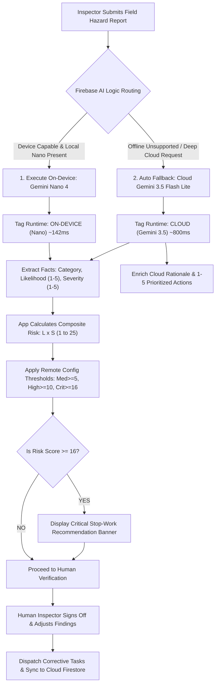

# FieldGuard AI 🛡️
> **Hybrid Edge-to-Cloud Workplace Safety Inspection Platform**  
> *Built for the #BuildHybridAI 2026 Hackathon*

[](LICENSE)
[](https://firebase.google.com/)
[](https://deepmind.google/technologies/gemini/nano/)
[](https://deepmind.google/technologies/gemini/)
[](https://www.osha.gov/)

---

## 📌 Executive Summary

**FieldGuard AI** is an enterprise-grade industrial safety inspection platform designed for construction sites, manufacturing plants, and high-risk operational facilities. 

In industrial environments, internet connectivity is notoriously unstable or completely absent (underground tunnels, offshore oil platforms, concrete basements). When life-safety hazards occur (exposed 440V lines, structural scaffolding failures, toxic leaks), waiting for a cloud server round-trip can cost human lives.

FieldGuard AI solves this with **Firebase AI Logic Hybrid Inference**:
1. **On-Device (Edge Local)**: Instant, sub-200ms hazard extraction and initial risk calculation using **Gemini Nano 4** in supported environments with **zero network dependency**.
2. **Cloud Fallback & Deep Analysis**: Seamless, automatic escalation to **Gemini 3.5 Flash Lite** in the cloud for multi-factor causal engineering rationale and prioritized corrective actions.
3. **Certified Human-in-the-Loop**: A strict design principle where **AI never declares any workplace safe**; qualified safety professionals verify findings and dispatch corrective action tasks.

---

## 🏆 #BuildHybridAI Hackathon Judging Criteria Alignment

| Judging Criteria | How FieldGuard AI Delivers | Concrete Evidence in Repo |
| :--- | :--- | :--- |
| **1. Technological Implementation** | Production-grade implementation of Firebase AI Logic SDK (`firebase/ai`). Uses `PREFER_ON_DEVICE` with Gemini Nano locally, auto-falling back to Gemini 3.5 Flash Lite in the cloud. Strict schema validation, Firebase Remote Config thresholds, App Check security, and 100% unit-tested risk engine. | `web/src/lib/firebase.ts`<br>`shared/risk-engine.ts`<br>`shared/classifier-validator.ts` |
| **2. Design & User Experience** | A complete, coherent industrial safety operating system—not just an isolated prompt demo. 7 cohesive workflows: Auth, Main Dashboard, ISO 5×5 Risk Heatmap, Field Intake, Hybrid AI Evaluation, Corrective Task Tracker, and Audit Reports. | `design.md`<br>`web/src/features/`<br>`docs/architecture.md` |
| **3. Potential Impact** | Direct life-safety impact for 10M+ construction & industrial workers. Eliminates reporting delays in disconnected zones, halts fatal hazard progression via stop-work triggers, and tracks corrective tasks from assignment to verified resolution. | `docs/architecture.md`<br>`shared/cloud-analyst-schema.json` |
| **4. Quality of the Idea** | Creative, non-obvious edge-to-cloud functional split: Gemini Nano handles rapid localized triage, while Cloud Gemini 3.5 handles cross-standard OSHA/ISO compliance and causal rationale. Adheres to strict safety engineering ethics. | `shared/classifier-prompt.md`<br>`docs/cloud-analyst.md` |

---

## 🏗️ System Architecture & Hybrid AI Flow



---

## 💻 Technology Stack

- **Client Web Application:** React 19, TypeScript, Vite 6, Tailwind CSS.
- **Backend & Cloud:** Google Firebase (Project: `fieldguard-ai`).
- **Database:** Cloud Firestore (`asia-south1`, production mode).
- **Security & Attestation:** Firebase App Check & Firebase Authentication.
- **Dynamic Configuration:** Firebase Remote Config (`risk_threshold_medium: 5`, `risk_threshold_high: 10`, `risk_threshold_critical: 16`).
- **Hybrid AI Engine:** Firebase AI Logic Hybrid Inference SDK (`firebase/ai`).
  - **Local Model:** Gemini Nano 4 (via Chrome Built-in AI / Prompt API & Android AICore).
  - **Cloud Model:** Gemini 3.5 Flash Lite via Google AI Developer API.

---

## 👥 Team Responsibilities & Ownership

| Team Member | Role | Primary Responsibilities | Key Repository Artifacts |
| :--- | :--- | :--- | :--- |
| **Humna Fahad Ali** | **Team Lead & Cloud AI Architect** | Cloud AI implementation (`gemini-3.5-flash-lite`), Cloud Analyst prompt specifications, architecture coordination, project documentation, Web scaffold, and review workflows. | `shared/cloud-analyst-*`<br>`docs/`<br>`web/src/features/analysis`<br>`web/src/features/review` |
| **Younus Hassan Khan** | **On-Device AI Specialist** | Local AI inference (`Gemini Nano 4`), classifier prompt, response validator, shared risk engine, and observation capture. | `shared/classifier-*`<br>`shared/risk-*`<br>`web/src/features/capture`<br>`web/src/features/history` |
| **Maaz Nadeem** | **Backend & Fullstack Engineer** | Cloud Firestore database schema, security rules, Remote Config parameters, actions tracking board, and dashboard analytics. | `shared/firestore*`<br>`shared/Remote_config.md`<br>`web/src/features/actions`<br>`web/src/features/dashboard` |

---

## 🚀 Quick Start (Running Locally)

### Prerequisites
- Node.js (v20+ recommended)
- npm (v10+)
- Google Chrome (Canary / Dev channel recommended with `#prompt-api-for-gemini-nano` flag enabled to test on-device inference)

### 1. Clone the Repository
```bash
git clone https://github.com/Younushk123/FieldGuard_AI.git
cd FieldGuard_AI
```

### 2. Run Shared Tests (Risk Engine & Classifier Validator)
```bash
cd shared
npm install
npm test
cd ..
```

### 3. Run Web Application
```bash
cd web
npm install
npm run dev
```
Open `http://localhost:5173` in your browser.

---

## 📄 Key Documentation Links

- 📐 **[UI/UX Design System Specification](design.md)**
- 🏛️ **[Detailed Hybrid AI Architecture](docs/architecture.md)**
- ☁️ **[Cloud Analyst Specification (Gemini 3.5)](docs/cloud-analyst.md)**
- 🔒 **[Security & App Check Guidelines](SECURITY.md)**
- 📜 **[Team Git Workflow](docs/workflow.md)**

---

## ⚖️ License

FieldGuard AI is licensed under the **Apache License 2.0**. See the [LICENSE](LICENSE) file for details.
