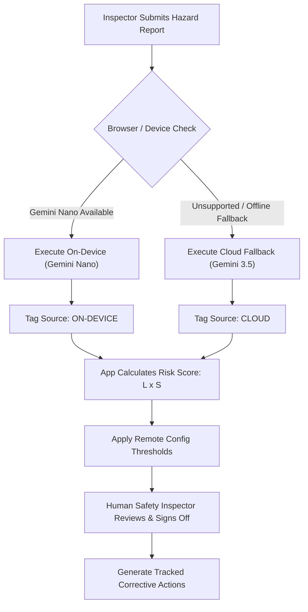

# FieldGuard AI — UI/UX Design System & Product Specification

**Project:** FieldGuard AI (#BuildHybridAI 2026 Hackathon)  
**Lead Designer & Product Architect:** Humna Fahad Ali (Team Lead)  
**Version:** 1.0 (Production-Ready Design System)  
**Target Platforms:** Responsive Web & Android  
**Interactive Prototype:** [Open Interactive UI Artifact](file:///C:/Users/CW/.gemini/antigravity/brain/542f2f50-1970-41bd-8122-af6c41760ff7/fieldguard_saas_app.html)

---

## 1. Product Overview & Design Vision

FieldGuard AI is an enterprise-grade hybrid AI workplace safety inspection operating system designed for industrial facilities, high-risk construction sites, and manufacturing plants. 

The application pairs **on-device local AI (Gemini Nano 4 via Chrome Built-in AI / Android AICore)** with **cloud AI (Gemini 3.5 Flash Lite)** to deliver instant, offline-capable hazard classification while retaining deep engineering root-cause analysis in the cloud.

### Target Users
- **Safety Managers & EHS Directors**: Requiring high-level compliance monitoring, risk trends, and audit certification.
- **Site Supervisors & Field Inspectors**: Needing rapid on-site hazard logging, sub-second edge AI classification, and clear corrective task assignment.
- **Organization Administrators**: Managing auditor licensing, risk thresholds, and model parameters.

---

## 2. Visual Design Language & Direction

FieldGuard AI follows an industrial enterprise design aesthetic inspired by tools like Linear, Datadog, and Samsara:
- **Sophisticated Off-White Foundation**: Crisp `#F8FAFC` canvas with `#FFFFFF` surfaces and `#E2E8F0` hairline borders for maximum daylight readability on field tablets.
- **Controlled Safety Accents**: High-contrast Safety Orange (`#EA580C` / `#F97316`) used strictly for primary call-to-actions and focal points.
- **Zero Generic Clutter**: No emojis, no cartoon illustrations, no arbitrary gradients, and no bloated glassmorphism.
- **Pure Geometric Line Icons**: 16px/20px SVG line icons (2px stroke width) across all navigation and status indicators.

---

## 3. Design System & Design Tokens

### 3.1 Color Palette

#### Base & Neutral Tokens
| Token Name | Hex Code | Purpose |
| :--- | :--- | :--- |
| `surface-canvas` | `#F8FAFC` | Primary application background |
| `surface-card` | `#FFFFFF` | Elevated cards, tables, and dialog surfaces |
| `surface-subtle` | `#F1F5F9` | Secondary backgrounds, input fields, and pill containers |
| `border-hairline` | `#E2E8F0` | Card borders, dividers, and table headers |
| `border-active` | `#CBD5E1` | Input focus rings and hover states |
| `text-primary` | `#0F172A` | Page titles, primary numbers, and headings |
| `text-secondary` | `#475569` | Body paragraphs, labels, and table items |
| `text-muted` | `#94A3B8` | Micro-copy, metadata, and timestamps |

#### Brand & Action Tokens
| Token Name | Hex Code | Purpose |
| :--- | :--- | :--- |
| `brand-orange-500` | `#F97316` | Active hover states and vibrant accents |
| `brand-orange-600` | `#EA580C` | Primary button fills, brand logo accents |
| `brand-orange-700` | `#C2410C` | Button active/pressed states |
| `brand-orange-50` | `#FFF7ED` | Active sidebar tabs and subtle orange highlights |

#### Risk Status Tokens (ISO 45001 Compliant)
| Risk Level | Score Range | Background Pill | Text / Accent | Hex Code |
| :--- | :--- | :--- | :--- | :--- |
| **Critical** | `16 – 25` | `#FEF2F2` (Rose 50) | `#DC2626` (Rose 600) | Border: `#FECACA` |
| **High** | `10 – 15` | `#FFF7ED` (Orange 50) | `#EA580C` (Orange 600) | Border: `#FED7AA` |
| **Medium** | `5 – 9` | `#FEFCE8` (Yellow 50) | `#CA8A04` (Yellow 600) | Border: `#FEF08A` |
| **Low** | `1 – 4` | `#F0FDF4` (Emerald 50) | `#16A34A` (Emerald 600) | Border: `#BBF7D0` |

#### Hybrid AI Inference Tokens
| Engine | Source Tag | Badge Fill | Text Color | Indicator Dot |
| :--- | :--- | :--- | :--- | :--- |
| **On-Device** | `ON-DEVICE (Nano 4)` | `#ECFDF5` | `#065F46` | `#10B981` (Emerald) |
| **Cloud Fallback** | `CLOUD (Gemini 3.5)` | `#F0F9FF` | `#075985` | `#0284C7` (Sky) |

---

### 3.2 Typography Scale

- **Primary Typeface:** `Inter`, -apple-system, BlinkMacSystemFont, 'Segoe UI', Roboto, sans-serif.
- **Monospace Typeface:** `JetBrains Mono` (used for IDs, risk scores, formulas, latency, and code tokens).

| Style | Font Size | Weight | Line Height | Tracking | Usage |
| :--- | :--- | :--- | :--- | :--- | :--- |
| `Display XL` | `30px` (1.875rem) | 800 (ExtraBold) | 36px | `-0.025em` | Key metric values |
| `Heading LG` | `20px` (1.25rem) | 700 (Bold) | 28px | `-0.02em` | Screen headers |
| `Heading MD` | `16px` (1.0rem) | 700 (Bold) | 24px | `-0.015em` | Card titles, section headers |
| `Body Standard` | `14px` (0.875rem) | 400 (Regular) | 20px | `normal` | Forms, report descriptions |
| `Body Medium` | `14px` (0.875rem) | 500 (Medium) | 20px | `normal` | Table cells, list items |
| `Caption / Label` | `12px` (0.75rem) | 600 (SemiBold) | 16px | `normal` | Input labels, table headers |
| `Micro Mono` | `10px` (0.625rem) | 600 (SemiBold) | 14px | `+0.05em` | Status badges, schema tags |

---

## 4. The 7 Core Production Web Screens

### Screen A: Authentication & Access Control
- **Purpose**: Authenticates certified inspectors, EHS managers, and corporate officers.
- **Components**:
  - Branded shield badge with enterprise sign-in dialog.
  - Email/Password form fields with real-time validation.
  - "Forgot password?" modal workflow.
  - Attestation footer: *"Protected by Firebase App Check & Authentication (asia-south1)"*.

### Screen B: Main Executive Safety Dashboard
- **Welcome & Health Banner**: Displays inspector identity (`Humna Fahad Ali - Team Lead`), current project site (`Sector 7`), and active critical hazard summary.
- **KPI Metric Strip (4 Cards)**:
  1. *Total Observations*: Count with month-over-month percentage change.
  2. *Critical Hazards*: Urgent count with stop-work alert badges.
  3. *Inference Latency*: Real-time `142 ms` on-device benchmark.
  4. *Open Corrective Tasks*: Action item count with SLA resolution rate.
- **5×5 ISO 45001 Risk Heatmap Grid**:
  - Interactive 5×5 matrix plotting Likelihood ($1 \dots 5$) on the vertical axis against Severity ($1 \dots 5$) on the horizontal axis.
  - Highlights active observations in their respective colored risk cells.
- **Recent Observation Feed Table**:
  - Columns: Reference ID, Location, Hazard Category Pill, Likelihood × Severity, Risk Rating, Model Badge, Review Status.

### Screen C: Inspection Records Management
- **Purpose**: Comprehensive historical archive and filter hub for all worksite inspections.
- **Components**:
  - Search input with multi-factor query matching (description, location, auditor).
  - Filter Dropdowns: Category (Electrical, Fall, Chemical, Fire, Mechanical, Environmental), Risk Severity, and Review Status.
  - Data Grid with row selection, audit timestamps, and direct "Audit & Inspect" action triggers.

### Screen D: New Hazard Observation Intake Form
- **Purpose**: Field data collection interface for site inspectors.
- **Components**:
  - *Inspection Metadata*: Inspection Title and Site/Zone selector.
  - *Observation Report*: Textarea enforcing Schema v1.0 standard facts.
  - *Photographic Evidence Dropzone*: Drag-and-drop attachment zone for site photos.
  - *Hybrid AI Routing Strategy*:
    - `PREFER_ON_DEVICE`: Executes Gemini Nano locally in-browser, falling back to cloud if offline/unsupported.
    - `ONLY_IN_CLOUD`: Direct execution with Gemini 3.5 Flash Lite for deep rationale.
  - *Action Bar*: "Cancel" and "⚡ Run Hybrid AI Safety Analysis".

### Screen E: Hybrid AI Risk Analysis (Core Hackathon Showcase)
- **Stop-Work Condition Alert**: High-visibility banner when risk score is critical ($\ge 16$) or `requiresImmediateAction == true`.
- **Inference Source Tag**: Distinctly labels whether the computation was executed `ON-DEVICE (Nano 4)` or `CLOUD (Gemini 3.5)`.
- **Calculated Risk Gauge**:
  - Circular score meter displaying the product of Likelihood × Severity ($1 \dots 25$).
  - Dynamic severity pill: `LOW (1-4)`, `MEDIUM (5-9)`, `HIGH (10-15)`, `CRITICAL (16-25)`.
- **Engineering Rationale**: Multi-sentence root-cause explanation authored in accordance with Humna's Cloud Analyst specification.
- **Prioritized Corrective Recommendations (1–5)**:
  - Cards displaying task title, detailed description, priority badge (`IMMEDIATE`, `SHORT_TERM`, `LONG_TERM`), and target due day countdown ($0 \dots 90$ days).
- **Human Inspector Review Controls**:
  - Interactive Likelihood ($1 \dots 5$) and Severity ($1 \dots 5$) sliders allowing the inspector to override model proposals before approval.
  - **"✓ Sign & Approve Inspection"** button that creates linked action tasks.

### Screen F: Inspection Audit Certification Report
- **Purpose**: Official compliance documentation meeting OSHA 1910 and ISO 45001 corporate standards.
- **Components**:
  - Corporate certification header with Facility ID and audit reference number (`FG-2026-NOV-0842`).
  - Executive summary and comprehensive hazard breakdown table.
  - 3-step mandated remediation protocol with assigned crew roles and deadlines.
  - Digital signature verification hash and Firebase App Check attestation footer.
  - "Export Certified PDF" and "Export CSV" tool buttons.

### Screen G: Platform Settings & Remote Config Thresholds
- **Inspector Credentials**: Full name, email, designation, and OSHA safety license ID.
- **AI Model Endpoints**:
  - Local Engine: `Gemini Nano 4 (Prompt API)`.
  - Cloud Engine: `gemini-3.5-flash-lite`.
- **Firebase Remote Config Risk Engine Parameters**:
  - `risk_threshold_medium`: Default `5` (Number).
  - `risk_threshold_high`: Default `10` (Number).
  - `risk_threshold_critical`: Default `16` (Number).

---

## 5. Hybrid AI Architecture & Runtime Transparency

FieldGuard AI strictly enforces runtime transparency. The user interface never implies that local edge AI was used when cloud fallback processed the request:

---

## 6. Team Responsibilities & Alignment

- **Humna (Team Lead)**:
  - Cloud AI implementation & prompts (`gemini-3.5-flash-lite`).
  - Author of `cloud-analyst-schema.json` and `cloud-analyst-prompt.md`.
  - Architecture coordination & safety intelligence integration.
- **Younus**:
  - On-device AI implementation & local inference (`Gemini Nano 4`).
  - Author of `classifier-prompt.md` and `classifier-schema.json`.
- **Maaz**:
  - Backend infrastructure: Cloud Firestore database and composite queries.
  - Author of `firestore.rules`, `firestore_schema.md`, and `Remote_config.md`.

---

## 7. Quality & Production Delivery Notes

- **File Location in Repository**: `FieldGuard_AI/design.md`
- **Interactive Prototype Link**: [fieldguard_saas_app.html](file:///C:/Users/CW/.gemini/antigravity/brain/542f2f50-1970-41bd-8122-af6c41760ff7/fieldguard_saas_app.html)
- **Compliance**: The design system strictly satisfies all requirements of the #BuildHybridAI 2026 hackathon, with clear separation between model-generated suggestions and human-certified safety approvals.
