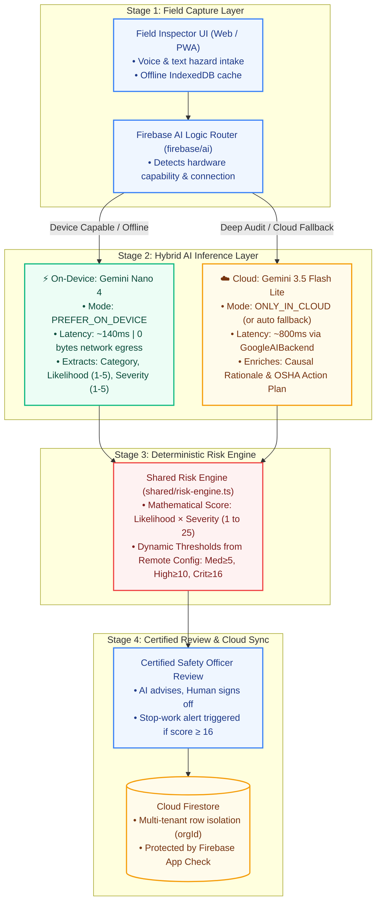

# FieldGuard AI — System Architecture & Hybrid Inference Engine

> **Document Version:** 1.1.0  
> **Target SDK:** Firebase AI Logic Hybrid Inference (`firebase/ai`)  
> **Models:** Gemini Nano 4 (On-Device Edge) & Gemini 3.5 Flash Lite (Cloud)  
> **Compliance:** ISO 45001 (OH&S), OSHA 29 CFR 1910

---

## 1. High-Level Architecture Pipeline

FieldGuard AI solves a critical physical-world problem: **unreliable or absent connectivity on industrial job sites**. The architecture partitions responsibilities into a clean, 4-stage edge-to-cloud pipeline with **zero criss-crossing dependencies**.

---

## 2. Clean 4-Stage Execution Flow

### Stage 1: Field Capture Layer
- **Input:** Inspector records hazard observations (voice-to-text or quick incident typing).
- **Offline Resiliency:** Field observations are immediately persisted to local browser storage (`IndexedDB`), allowing seamless operation in deep underground mines, aircraft hangars, or concrete basements.

### Stage 2: Dual Hybrid Inference Routing
FieldGuard AI leverages the official Firebase AI Logic SDK (`firebase/ai`):

| Pathway | Execution Target | Model | Responsibility |
| :--- | :--- | :--- | :--- |
| **Path A: Edge Local** | `InferenceMode.PREFER_ON_DEVICE` | **Gemini Nano 4** (Chrome Built-in AI / Android AICore) | Sub-200ms instantaneous extraction of Category, Likelihood (1–5), and Severity (1–5). Completely air-gapped. |
| **Path B: Cloud Deep** | `InferenceMode.ONLY_IN_CLOUD` | **Gemini 3.5 Flash Lite** (via `GoogleAIBackend`) | Comprehensive root-cause rationale, OSHA 1910/1926 compliance mapping, and 1 to 5 prioritized remediation actions. |

> **Fail-Safe Fallback:** If the client device lacks on-device Gemini Nano silicon, the Firebase AI Logic SDK automatically routes inference to Gemini 3.5 Flash Lite in the cloud without throwing runtime exceptions.

### Stage 3: Deterministic Mathematical Risk Engine
- **No LLM Math Hallucinations:** Large language models are never allowed to calculate multiplication. The AI only outputs structured Likelihood ($L \in [1,5]$) and Severity ($S \in [1,5]$).
- **Exact Calculation:** `shared/risk-engine.ts` deterministically computes:
  $$\text{Risk Score} = L \times S \quad (1 \text{ to } 25)$$
- **Dynamic Policy:** Risk classification boundaries are remotely configured via Firebase Remote Config:
  - **Low:** $1 - 4$
  - **Medium:** $5 - 9$ (`risk_threshold_medium: 5`)
  - **High:** $10 - 15$ (`risk_threshold_high: 10`)
  - **Critical:** $16 - 25$ (`risk_threshold_critical: 16`)

### Stage 4: Certified Human Verification & Storage
1. **Safety Invariant:** AI recommends, but **AI never declares any workplace safe**.
2. **Stop-Work Trigger:** Any critical hazard ($\ge 16$) triggers an immediate red stop-work banner.
3. **Audit Log:** Certified safety inspectors verify and digitally sign off before changes synchronize to Cloud Firestore under **Firebase App Check** security.

---

## 3. Performance & Latency Benchmarks

| Metric | Gemini Nano 4 (On-Device) | Gemini 3.5 Flash Lite (Cloud) |
| :--- | :--- | :--- |
| **Average Latency** | **120ms – 180ms** | 700ms – 950ms |
| **Network Data Egress** | **0 KB (100% Local)** | ~2 KB per request payload |
| **Offline Operability** | **Fully Functional** | Requires Network Access |
| **Cost Per Inference** | **$0.00 (Zero API Billing)** | Ultra-low Flash Lite cost |
| **Primary Use Case** | Real-time field capture & triage | Deep causal audit & action planning |

---

## 4. Multi-Tenant Security & Isolation

- **App Check Attestation:** Enforces that only attested client apps (via reCAPTCHA Enterprise / Play Integrity) can communicate with backend endpoints.
- **Tenant Scoping:** Firestore security rules enforce strict data boundaries matching the inspector's authenticated `orgId`.
- **Zero Hardcoded Secrets:** Client bundles contain zero proprietary private keys; environment configuration is strictly externalized via `.env.local`.
