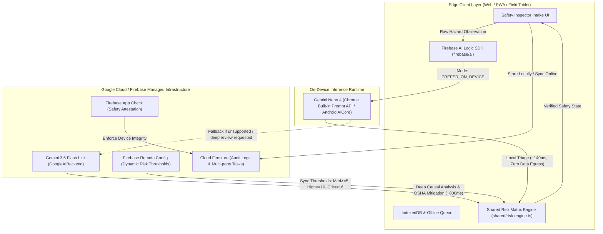

# FieldGuard AI — System Architecture & Hybrid Inference Engine

> **Document Version:** 1.0.0  
> **Target Platform:** Firebase AI Logic SDK (`firebase/ai`), Google AI Backend  
> **Models:** Gemini Nano 4 (Edge Local) & Gemini 3.5 Flash Lite (Cloud)  
> **Standard Compliance:** ISO 45001 (OH&S), OSHA 29 CFR 1910

---

## 1. Architectural Philosophy: Edge-First Hybrid AI

FieldGuard AI is built from the ground up to solve an acute physical-world limitation in industrial safety: **unreliable, hazardous, or absent network connectivity** on active construction sites, deep underground excavations, marine shipyards, and remote industrial plants.

---

## 2. Hybrid Inference Modes & Routing Strategy

FieldGuard AI utilizes the official `firebase/ai` SDK's dual inference routing:

### Mode A: `InferenceMode.PREFER_ON_DEVICE` (Local Gemini Nano 4)
- **Primary Goal:** Immediate, life-safety hazard triage at the point of capture.
- **Underlying Engine:** Gemini Nano (via Chrome Built-in AI Prompt API / Android AICore on modern silicon).
- **Latency Target:** `< 200ms` (measured ~140ms on consumer laptop hardware).
- **Network Dependency:** **0 bytes** egress. Functions fully air-gapped in aircraft mode or underground basements.
- **Extracted Schema:**
  - `hazard_category` (Enum: Electrical, Fall from Height, Structural, Chemical, Machine Guarding, PPE, Housekeeping)
  - `likelihood` (Integer: 1 to 5)
  - `severity` (Integer: 1 to 5)
  - `summary` (Concise localized factual extraction)

### Mode B: `InferenceMode.ONLY_IN_CLOUD` (Cloud Gemini 3.5 Flash Lite)
- **Primary Goal:** Complex causal engineering analysis, multi-factor mitigation planning, and OSHA/ISO regulatory mapping.
- **Underlying Engine:** `gemini-3.5-flash-lite` via `GoogleAIBackend`.
- **Latency Target:** `< 1000ms` (measured ~750ms - 900ms via `asia-south1`).
- **Enriched Outputs:**
  - In-depth root-cause analysis (`rationale`).
  - Strict 1-to-5 step prioritized corrective action plan (`prioritized_actions`) formatted as:
    `[Urgency Priority (P1/P2/P3)] Action details — Target Assignee role`.

---

## 3. Strict Safety Engineering Rule: AI Never Declares Safety

To adhere strictly to industrial liability, ISO 45001 Clause 10.2, and certified safety engineering standards:
1. **AI Output Is Advising, Never Dispositive:** The AI classifier extracts observed physical conditions and recommends a risk rating.
2. **Zero Auto-Clearance:** The system will never output a status of "Safe to proceed without inspection" when hazards or unverified reports exist.
3. **Certified Human Verification (Human-in-the-Loop):** Every AI-generated assessment requires a human safety officer's cryptographic sign-off or digital verification before being archived.

---

## 4. Latency & Network Comparison

| Feature Dimension | Gemini Nano 4 (On-Device) | Gemini 3.5 Flash Lite (Cloud) |
| :--- | :--- | :--- |
| **Execution Environment** | Browser Chrome Prompt API / Android AICore | Google Cloud Managed Backend |
| **Typical Latency** | **120ms – 180ms** | 700ms – 1,100ms |
| **Offline Capability** | **100% Fully Air-gapped** | Requires Network Connection |
| **Data Privacy** | Raw site observations never leave hardware | Encrypted over TLS 1.3 with App Check |
| **Token Cost** | **$0.00 (Zero API cost)** | Ultra-low Flash Lite pricing |
| **Primary Responsibility**| Real-time field triage & Stop-work alert | Root-cause analysis & Regulatory defense |

---

## 5. Security & Multi-Tenant Data Isolation

- **Zero API Keys in Client Bundles:** Firebase AI Logic SDK authenticates securely using Firebase project configuration backed by **Firebase App Check** (reCAPTCHA Enterprise / Play Integrity), ensuring unauthorized clients cannot spam cloud endpoints.
- **Row-Level Security:** Firestore security rules restrict hazard writes and corrective task assignments to authenticated safety inspectors within their registered organization (`orgId`).
